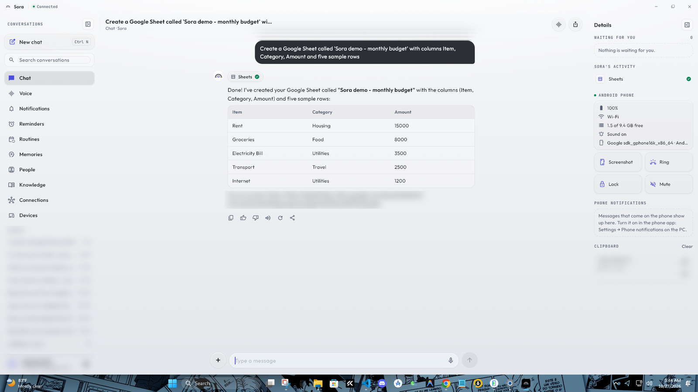
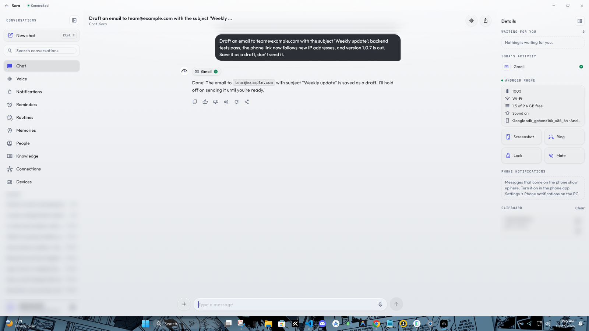
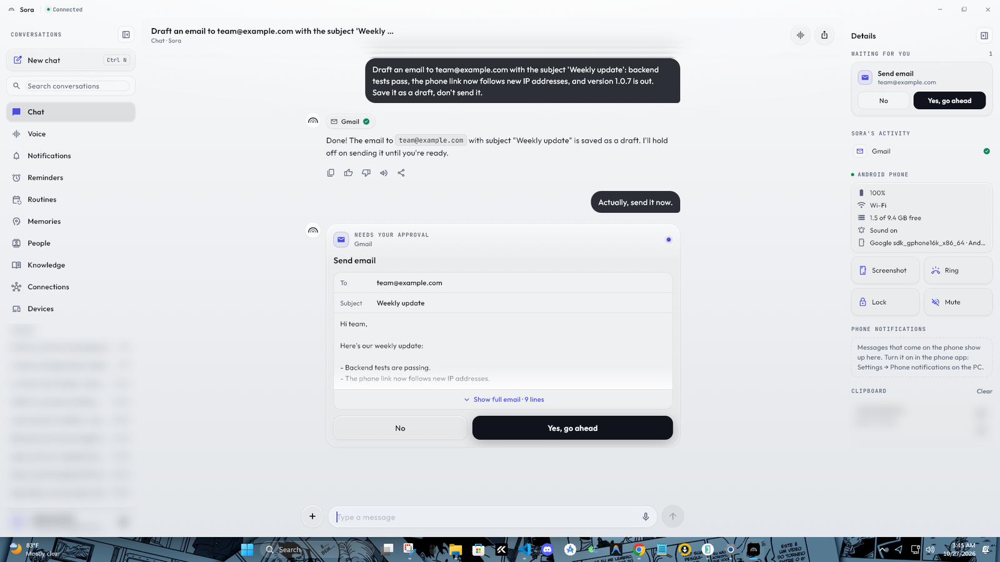
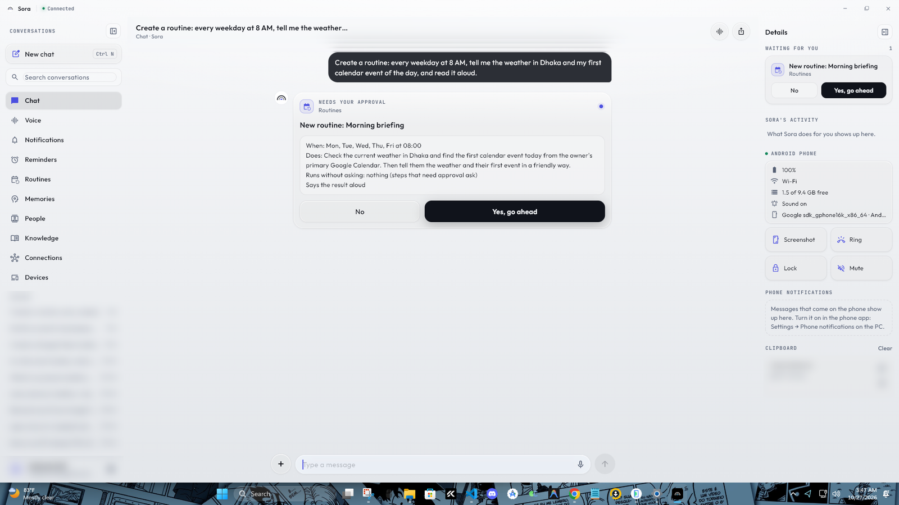
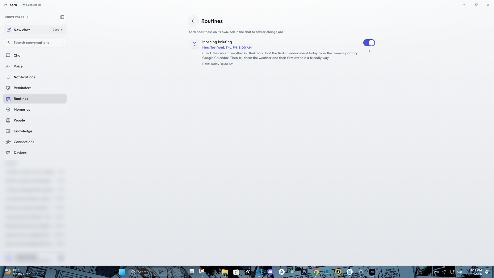
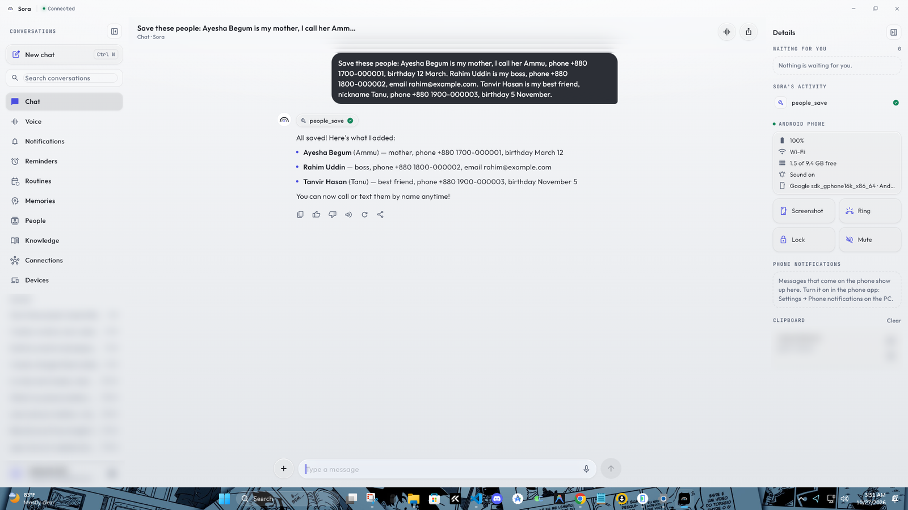
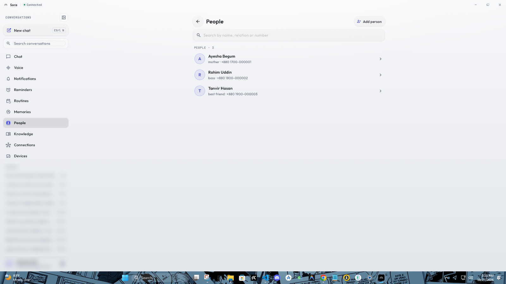
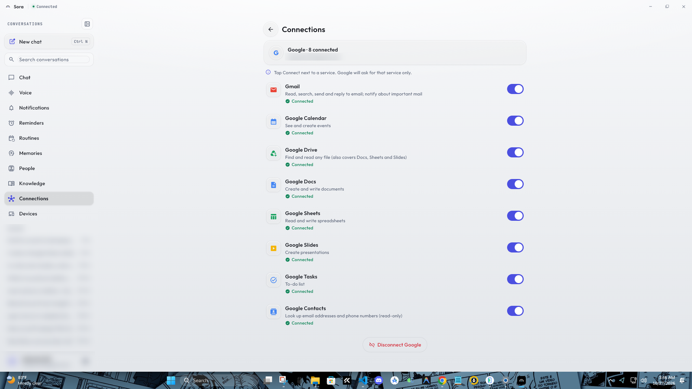
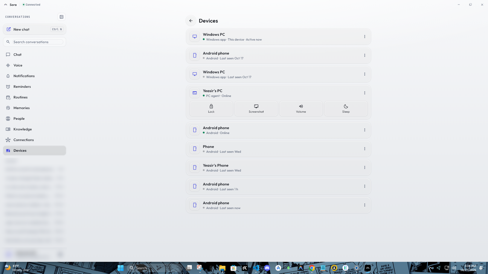
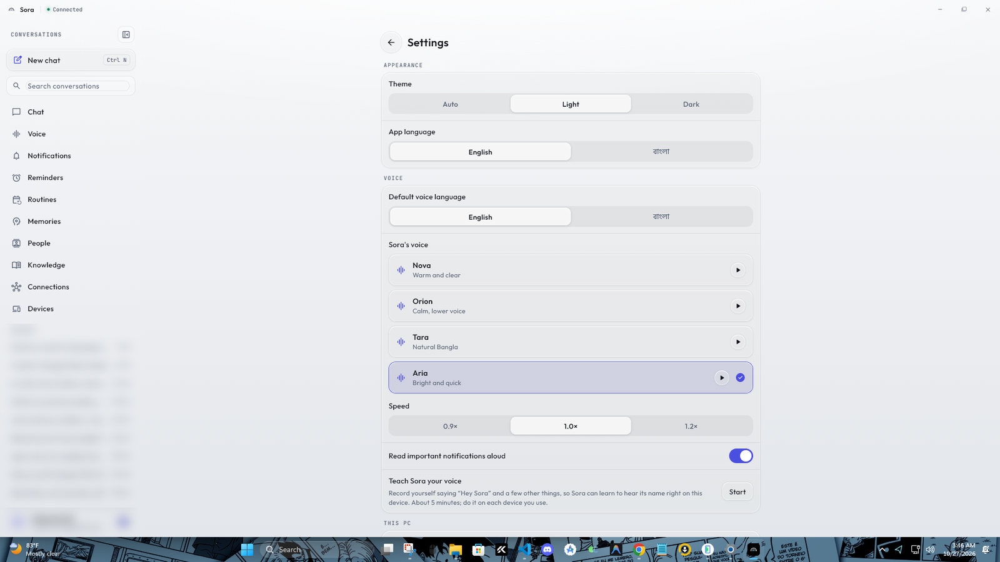

# Sora

**A personal AI assistant that lives on your own PC and works across your Windows computer and Android phone.**
Talk to it by text or voice, in English, Bangla or a mix of both. It answers questions, works with your Google
account (Gmail, Calendar, Drive, Docs, Sheets, Slides, Tasks, Contacts), remembers things for you, runs routines on
its own and controls both devices. Anything risky waits for your approval.

<p align="center">
  
</p>

<table>
  <tr>
    <td align="center"><br><sub>Phone app</sub></td>
    <td align="center"><br><sub>Ask about the PC from the phone</sub></td>
    <td align="center"><br><sub>Reminders</sub></td>
    <td align="center"><br><sub>Voice mode</sub></td>
  </tr>
</table>

---

## Contents

- [Highlights](#highlights)
- [The Windows app](#the-windows-app)
- [The phone app](#the-phone-app)
- [Features in detail](#features-in-detail)
  - [Google: Gmail, Calendar, Drive, Docs, Sheets, Slides, Tasks, Contacts](#google-gmail-calendar-drive-docs-sheets-slides-tasks-contacts)
  - [PC control](#pc-control)
  - [Phone control](#phone-control)
  - [Routines and reminders](#routines-and-reminders)
  - [Memory, people and knowledge](#memory-people-and-knowledge)
  - [Voice](#voice)
  - [Browser, VS Code and Claude Code](#browser-vs-code-and-claude-code)
  - [Approvals](#approvals)
- [How it works](#how-it-works)
- [Getting started](#getting-started)
- [Configuration](#configuration)
- [Security and privacy](#security-and-privacy)
- [Development](#development)
- [Project layout](#project-layout)

## Highlights

- **One assistant, two devices.** Ask on the phone about the PC, or on the PC about the phone. The clipboard is
  shared between them, and the phone's notifications show on the PC.
- **Bilingual.** English, Bangla and Banglish in chat and voice. Sora replies in the language you write in.
- **Google automation.** Read, search, draft and send email. Manage your calendar. Create Docs, Sheets and Slides.
  Find Drive files. Keep a to-do list.
- **Runs things on its own.** Routines start on a schedule or when something happens: an email arrives, the phone's
  battery gets low, a web page changes, a WhatsApp message comes in.
- **Hands-free.** Say "Hey Sora" on the phone or the PC. A small orb shows on the PC while it listens.
- **Self-hosted and approval-first.** Your data stays on your machine. Sending, deleting and shutting down always
  ask you first.

## The Windows app

The Windows app has three columns. Both side columns fold away.

| Left: navigation | Middle: the current screen | Right: the Details panel |
|---|---|---|
| New chat (Ctrl+N), search, and every screen: **Chat, Voice, Notifications, Reminders, Routines, Memories, People, Knowledge, Connections, Devices**, plus recent conversations and Settings. | The chat, or whichever screen you opened. | **Waiting for you:** approvals you can answer in one click. **Sora's activity:** each tool Sora used (Gmail, Sheets, PC, Phone…). **Android phone:** battery, network, storage and sound, with Screenshot, Ring, Lock and Mute buttons. **Phone notifications** as they arrive. **Clipboard** history from both devices. |

It also runs from the tray (it keeps running when you close the window), can start with Windows, and shows phone
notifications as Windows toasts.

**Gmail: draft an email.** The tool Sora used appears in *Sora's activity* on the right.



**Approval first.** Asked to send that draft, Sora shows the full email and waits. The same card appears under
*Waiting for you*.



**Routines.** A routine is described in plain language. Sora shows exactly what it will do before it is saved,
and lists it under Routines afterwards.

| Proposed | Saved |
|---|---|
|  |  |

**People.** Tell Sora about the people in your life in one sentence. It saves each relation, nickname, number,
email and birthday, so "call Ammu" or "text my boss" just works. (The people shown are made-up examples.)

| Told in the chat | The People screen |
|---|---|
|  |  |

**Ask about the phone from the PC**


**What Sora can do, in its own words**


**Connections and devices.** Each Google service is connected separately, and Google asks only for that service.
Devices lists every phone, PC and app signed in, each with its own revocable token, plus quick PC actions.

| Connections | Devices |
|---|---|
|  |  |

**Voice mode and Settings**

| Voice | Settings |
|---|---|
|  |  |

**The corner orb.** When you say "Hey Sora" on the PC, a small orb appears above the clock while Sora listens,
thinks and speaks. It never takes the focus, and clicks pass through it.

| Speaking | Listening |
|---|---|
|  |  |

## The phone app


- The same screens as on Windows: Chat, Voice, Conversations, Notifications, Reminders, Routines, Memories,
  People, Knowledge, Connections, Devices and Settings. Light, dark or automatic theme.
- **Stays connected with the app closed.** A light link inside Sora's accessibility service keeps the phone
  reachable from the PC, without an extra foreground service or wake locks. A quiet "Connected to the PC"
  notification has a Disconnect button.
- **Finds the PC by itself** on the home Wi-Fi, and follows it when the router gives the PC or the phone a new
  address.
- **"Hey Sora" hands-free**, with a glow round the edge of the screen while Sora talks.
- **Shares the clipboard** (text and new screenshots) with the PC.
- **Mirrors notifications to the PC** from the apps you choose (WhatsApp, Messenger, SMS…).
- **Push notifications** for reminders, important email and routine results, read aloud if you like.

<br clear="right">

## Features in detail

Sora gives the LLM about 60 tools. Grouped by area:

### Google: Gmail, Calendar, Drive, Docs, Sheets, Slides, Tasks, Contacts

Connect once with **Connect Google**. Each service can be switched on or off separately.

| Service | What Sora can do |
|---|---|
| **Gmail** | Search mail, read a message, save a draft, reply in the thread, send new mail (with approval), mark read or unread, archive, star or trash. |
| **Inbox watcher** | New mail is rated by importance using rules you write in plain language ("always tell me about mail from my supervisor", "never about newsletters"). Important mail reaches the phone as a push notification and can be read aloud. Ask "what important emails came today?" at any time. |
| **Calendar** | List events in any range, create, update and delete events. Inviting guests or deleting asks first. |
| **Drive** | Find files and read the text of Docs, Sheets (as CSV), Slides, PDFs and text files. Copy a Drive file into the knowledge base. |
| **Docs** | Create a document with content, or append to an existing one. |
| **Sheets** | Create a spreadsheet (optionally with rows), list its tabs, read cells, append rows or overwrite cells. |
| **Slides** | Create a presentation: a title slide plus one slide per topic with bullet points. |
| **Tasks** | List, add and complete to-dos. |
| **Contacts** | Look up a person's email address or phone number (read-only). |

Example requests: *"Create a Google Sheet called 'Monthly budget' with columns Item, Category, Amount"*,
*"What's on my calendar tomorrow?"*, *"Reply to Karim's last email and say I'll send the report on Monday"*,
*"Make a 5-slide deck about our project for Thursday's meeting"*.

### PC control

The PC agent runs on Windows and carries out these actions (risky ones ask first):

| Area | Actions |
|---|---|
| Apps and windows | Open, close, list and uninstall apps. Microsoft Store search and install. List, focus, minimize, maximize and snap windows. |
| Keyboard | Type text, press shortcuts. |
| Files | Search files, open a file or folder, copy, move, rename, delete, zip and unzip, tidy the Downloads folder. File actions are limited to your user folders and the project folders you list. |
| Web and media | Open a URL, search Chrome or YouTube, play on YouTube, play/pause/next, volume. |
| System | Brightness, Wi-Fi, Bluetooth, dark mode, system info (CPU, RAM, disks, battery, uptime), processes (list and end), lock, sleep, shut down, restart, cancel a shutdown, log off. |
| Screen | Take a screenshot (shown in the chat), or look at the screen and answer a question about it ("how is my training run doing?"). |
| Clipboard and notices | Read or set the clipboard, show a Windows notification. |
| Watchers | Tell the phone when a download finishes or a training run ends (it watches the folders you choose). |
| Shell | Run a PowerShell command, only when the agent is started with `--allow-shell`, and each risky command is approved. |

### Phone control

| Area | Actions |
|---|---|
| Apps and web | Open or close apps, open a URL, search the web or YouTube, play music, open a settings page. |
| Calls and messages | Call someone (by name, nickname or relation from People), send an SMS, send a WhatsApp message, reply to a notification. Sending always asks first. |
| Clock | Set or cancel alarms and timers. |
| Device | Volume and media, flashlight, screenshot, lock, ring (find my phone), status (battery, charging, storage, network). |
| Maps | Start navigation in Google Maps. |
| Notifications | "What came on WhatsApp?" reads recent notifications from the phone. |

If you ask on the PC for something only a phone can do ("call Ammu"), it happens on the phone. Otherwise actions
run on the device you are talking from, unless you name the other one.

### Routines and reminders

- **Reminders** arrive as push notifications at the time you set ("remind me at 9 pm to call Ammu"), once or
  repeating daily or weekly.
- **Routines** are jobs Sora does on its own. Each one has a trigger and a plain-language instruction, and can read
  its result aloud:

| Trigger | Example |
|---|---|
| A time (daily or on chosen days) | "Every weekday at 8 AM, tell me the weather and my first meeting." |
| An interval | "Every 30 minutes, check if my build finished." |
| An email arrives (from someone, about something, or only important ones) | "When an email from the university arrives, summarize it." |
| The phone's battery drops below a level | "When my phone battery is below 20%, tell the PC." |
| The phone or PC comes online or goes offline, or the PC wakes from sleep | "When the PC wakes up, open my project in VS Code." |
| A notification arrives on the phone (from an app and a person or chat) | "When my boss messages me on WhatsApp, read it aloud on the PC." |
| A web page changes (a price, a notice, a result) | "Tell me when this product's price drops." |

Steps that need approval still ask while a routine runs, unless you allowed them when you created it.

### Memory, people and knowledge

- **Memories:** lasting facts and preferences ("I prefer short answers", "my thesis deadline is in May"). Sora uses
  them in later conversations. You can see, correct and delete each one.
- **People:** family, friends and colleagues with their relation, nicknames, phone numbers, emails, birthday and
  notes. "Call Ammu" or "text my boss" works by any of those names.
- **Knowledge base:** save notes, upload PDFs and Word files, save web pages or Drive files, then ask questions
  about them. Search combines pgvector embeddings and PostgreSQL full-text search, and works for Bangla, Banglish
  and English.
- **Web:** search the web (DuckDuckGo, Brave or Tavily) and read pages to answer up-to-date questions.
- **Notices:** reads the owner's university notice board on request.

### Voice

- **Push-to-talk or hands-free** on both apps, with a particle orb that reacts to listening, thinking and speaking.
- **"Hey Sora"** wake word on the phone and the PC. An on-device model decides when the name was said, and only
  then is speech sent to Whisper. *Teach Sora your voice* in Settings records a few samples to tune it for you.
- **Speech-to-text:** local Whisper on your GPU (free and private), Groq, OpenAI, or the phone's own recognizer.
- **Text-to-speech:** four voices (Nova, Orion, Tara, Aria), including a natural Bangla voice, at three speeds.

### Browser, VS Code and Claude Code

- **Browser:** Sora can drive a real browser on the PC step by step for sites that need clicks, a login or
  JavaScript. It uses its own profile, never types passwords, and asks before anything that submits, pays, buys,
  posts or sends.
- **VS Code:** with the Sora Bridge extension, Sora opens projects, reads, writes and edits files, searches, reads
  problems, runs commands in the terminal, uses git, and runs tasks and debugging. Terminal commands, deleting,
  committing and pushing ask first.
- **Claude Code:** Sora can hand a coding job in one of your projects to Claude Code on the PC, once you approve it.

### Approvals

Every action that sends something, deletes something, spends money, turns the PC off, or runs a risky command
waits for you. You see exactly what will happen (the full email, the routine's schedule and steps) and answer
**Yes** or **No** in the chat, in the Details panel, or by saying "yes" or "no". Once third-party content (an
email, a file, a web page) is in a conversation, anything that could carry data out or store injected text also
asks first.

## How it works

Sora has three parts, and all of them run on hardware you own:

```
 Android app ──┐   HTTPS + SSE (chat)               ┌── Google APIs (OAuth, tokens encrypted at rest)
 Windows app ──┼── WebSocket (events, commands) ──  Sora backend (FastAPI) ── any OpenAI-compatible LLM
 PC agent ─────┘                                    │      ├── email watcher · reminders · routines
                                                    │      └── PostgreSQL + pgvector
                                                    └── FCM push to the phone (optional)
```

- **Backend** (`backend/`, Python/FastAPI). The brain: the LLM loop and its tools, memory, knowledge base,
  reminders, routines, the Google integration and the live connection to every device.
- **PC agent** (`pc_agent/`, Python, Windows). Carries out PC actions, listens for "Hey Sora", watches downloads
  and training runs, and syncs the clipboard. It relies on Windows events, so idle CPU stays near zero.
- **App** (`app/`, Flutter). One codebase for Android and Windows, with a Java plugin for the phone's actions and
  its background link.

The phone finds the PC on the home network by itself. The server announces itself over UDP, and the phone
re-checks and follows the PC when the router gives either device a new address. Away from home, use
[Tailscale](https://tailscale.com).

## Getting started

### Requirements

| For | You need |
|---|---|
| Backend | Python 3.12+, PostgreSQL 15+ with [pgvector](https://github.com/pgvector/pgvector) |
| PC agent | Windows 10/11 and the same Python environment |
| Apps | [Flutter](https://flutter.dev) (Dart 3.12+). Android Studio to build the APK. Visual Studio (C++ desktop workload) and [Inno Setup 6](https://jrsoftware.org/isinfo.php) for the Windows installer |
| An LLM | An API key for OpenRouter or any OpenAI-compatible provider, with a model that supports tool calling |

### 1. Backend

The steps below run PostgreSQL inside WSL Ubuntu on Windows (about 400 MB). On Linux or a VPS, any PostgreSQL
with pgvector works. Leave `WSL_DISTRO` empty, or run `docker compose up -d`.

```powershell
# PostgreSQL + pgvector inside WSL (Ubuntu)
wsl -d Ubuntu -u root -- bash -c "apt-get update && apt-get install -y postgresql postgresql-18-pgvector && systemctl enable --now postgresql"
"CREATE ROLE sora LOGIN PASSWORD 'choose-a-password';" | wsl -d Ubuntu -u root -- su postgres -c psql
"CREATE DATABASE sora OWNER sora;"                      | wsl -d Ubuntu -u root -- su postgres -c psql
"CREATE EXTENSION vector;"                              | wsl -d Ubuntu -u root -- su postgres -c "psql -d sora"

# Python environment
py -3.12 -m venv .venv
.venv\Scripts\python -m pip install -e "backend[dev]"

# Configuration: copy the template, then fill in DATABASE_URL, WSL_DISTRO, LLM_API_KEY, LLM_MODEL, OWNER_NAME
copy .env.example .env

# Encryption key, database tables and the owner PIN
cd backend
..\.venv\Scripts\python -m sora setup

# Run (API docs at http://localhost:8000/docs)
..\.venv\Scripts\python -m sora serve
```

You can also talk to Sora in the terminal with `python -m sora chat`.

### 2. PC agent

```powershell
cd backend
..\.venv\Scripts\python -m sora create-device --name "My PC" --kind pc_agent --save-as PC_AGENT_TOKEN
cd ..
.venv\Scripts\python pc_agent\sora_pc_agent.py      # add --allow-shell to permit PowerShell commands (each one is still approved)
```

If VS Code is installed, the agent adds the **Sora Bridge** extension to it ([vscode_ext/README.md](vscode_ext/README.md)).
To start the server and the agent with Windows, run `scripts\install_autostart.ps1`.

### 3. Apps

```powershell
cd app
flutter pub get

# Android: app\build\app\outputs\flutter-apk\app-release.apk
flutter build apk --release

# Windows installer: app\build\installer\Sora-Setup-<version>.exe
powershell -ExecutionPolicy Bypass -File windows\installer\build.ps1
```

Open the app and enter the server address and the PIN you chose in `sora setup`. On the same Wi-Fi the phone
finds the PC by itself. On Android, turn on **Sora** under *Settings → Accessibility* so the phone stays connected
in the background and can carry out actions.

### Optional

- **Google:** follow [docs/google-setup.md](docs/google-setup.md) ([বাংলা](docs/google-setup.bn.md)). It takes
  about 15 minutes, once. Then press *Connect Google* in the app, or run `python -m sora connect-google`.
- **Away from home:** run `tailscale serve --bg 8000` on the PC to get a private HTTPS address that only your
  devices can reach.
- **Push notifications:** create a Firebase project, download a service-account key, keep it outside the repo, and
  set `FCM_SERVICE_ACCOUNT_FILE` in `.env`.

## Configuration

Every setting lives in `.env`. [.env.example](.env.example) lists and explains all of them. The main ones:

| Setting | What it is |
|---|---|
| `DATABASE_URL` | PostgreSQL connection (use `127.0.0.1`, not `localhost`, with WSL) |
| `LLM_BASE_URL`, `LLM_API_KEY`, `LLM_MODEL` | The chat model. Any model that supports tool calling |
| `LLM_FALLBACK_MODELS` | Models to try in order if the main one fails (OpenRouter) |
| `EMBEDDING_*` | Optional. Without a key, search falls back to PostgreSQL full-text search |
| `WEB_SEARCH_PROVIDER` | `duckduckgo` (no key), `brave` or `tavily` |
| `GOOGLE_CLIENT_ID`, `GOOGLE_CLIENT_SECRET` | Your own Google OAuth client ([setup guide](docs/google-setup.md)) |
| `EMAIL_WATCHER_ENABLED`, `GMAIL_POLL_SECONDS` | The inbox watcher |
| `STT_PROVIDER` | Speech-to-text: `local` (Whisper on your GPU), `groq`, `openai` or `none` |
| `PC_AGENT_TOKEN` | The PC agent's device token (created by `sora create-device`) |
| `PROJECT_DIRS` | Extra folders the PC agent may work with files in |
| `WAKE_WORD`, `CORNER_ORB` | "Hey Sora" on the PC, and the corner orb |
| `DOWNLOAD_WATCH`, `TRAINING_WATCH` | Tell the phone when a download or a training run finishes |

### A free setup

| Part | Free option |
|---|---|
| LLM | OpenRouter `:free` models, or the Gemini or Groq free tiers. ⚠️ Free tiers may use your data, including email content, for training. |
| Embeddings | Gemini `gemini-embedding-001`, or none (full-text search) |
| Speech-to-text | On-device on Android. On Windows: the Groq Whisper free tier, or local `faster-whisper` on the GPU (`pip install -e backend[local-stt]`) |
| Text-to-speech | Edge TTS |
| Hosting | Your own PC, with Tailscale for access from outside |

## Security and privacy

- **Your data stays with you.** The server, database and files run on your own machine. Only the LLM provider you
  choose sees the conversation.
- **Secrets stay out of git.** `.env` and `data/` are ignored, and `.env.example` holds no values. A gitleaks
  pre-commit hook blocks commits that contain keys. Run `git config core.hooksPath .githooks` once after cloning.
- **Google tokens are encrypted** at rest with Fernet (`ENCRYPTION_KEY`).
- **Each device has its own revocable token.** Only SHA-256 hashes of tokens are stored.
- **Untrusted content is fenced off.** Email, file and web content is marked untrusted for the LLM. There are no
  tools to delete or share Drive files.
- **Risky actions ask first** (see [Approvals](#approvals)). PowerShell on the PC is off unless the agent is started
  with `--allow-shell`.
- **The browser Sora drives** uses its own profile and never types passwords. You log in yourself.
- If a key ever leaks, **rotate it**. Deleting the commit is not enough.

## Development

```powershell
cd backend
..\.venv\Scripts\python -m pytest -q          # backend tests (uses a separate sora_test database)
cd ..
.venv\Scripts\python -m pytest -q pc_agent/tests
cd app
flutter analyze lib packages/sora_phone/lib   # Dart is formatted at width 140
```

How to add a phone or PC action, and the order of planned automation work, are described in [CLAUDE.md](CLAUDE.md)
and [docs/automation-roadmap.md](docs/automation-roadmap.md). The client protocol is in [docs/api.md](docs/api.md).

## Project layout

```
backend/sora/
  agent/        LLM loop, system prompt and tools (Google, knowledge, reminders, routines, devices, people, browser, VS Code)
  api/          REST and WebSocket routes (auth, chat, connections, knowledge, voice, clipboard, ws)
  google/       OAuth and REST helpers for Gmail and Workspace
  llm/          OpenAI-compatible chat and embedding clients
  services/     email watcher, reminders, routines, RAG, device hub, voice, phone discovery
pc_agent/       Windows agent: PC actions, "Hey Sora", corner orb, watchers, clipboard, browser, VS Code bridge
app/            Flutter app for Android and Windows
  lib/            desktop/ (Windows shell, sidebar, Details panel), shell/ (phone), chat, voice, lists, settings
  lib/l10n/       every string in English and Bangla
  packages/sora_phone/   Android plugin: phone actions and the background link (Java)
vscode_ext/     Sora Bridge, the VS Code extension
scripts/        setup, autostart and wake-word training helpers
docs/           client API, Google setup, automation roadmap, screenshots
```

CLI: `python -m sora setup | serve | migrate | set-password | create-device | chat | connect-google | reindex | poll-email`

## License

[MIT](LICENSE)
