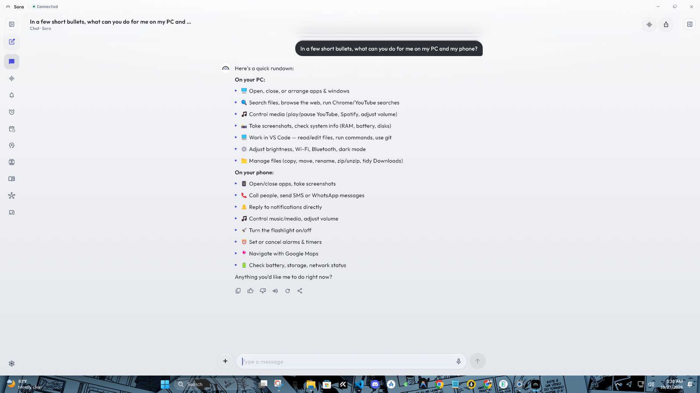
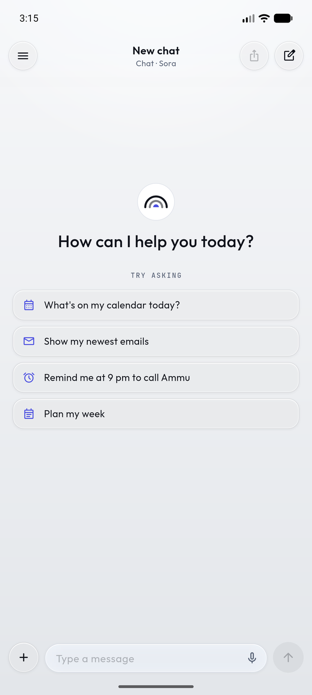
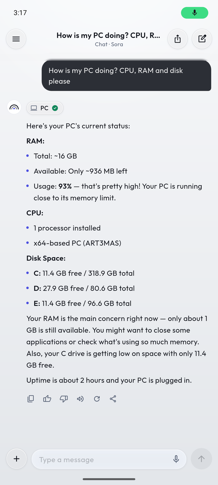
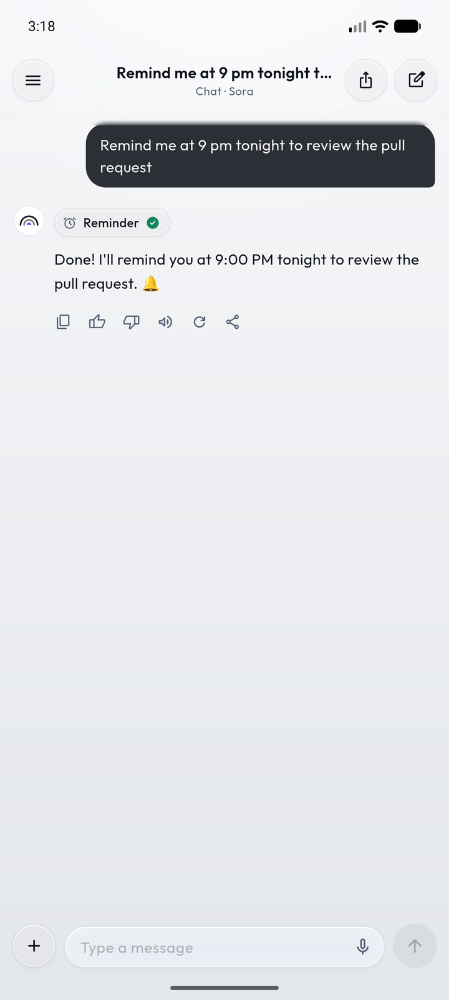
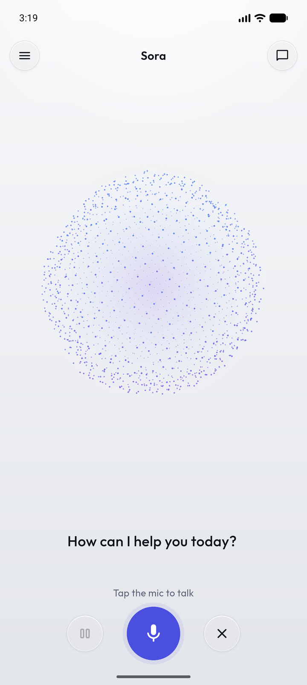
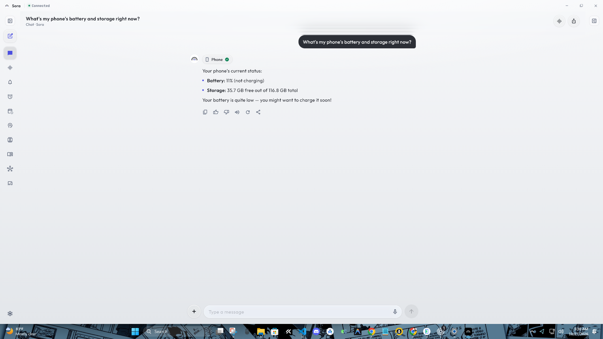
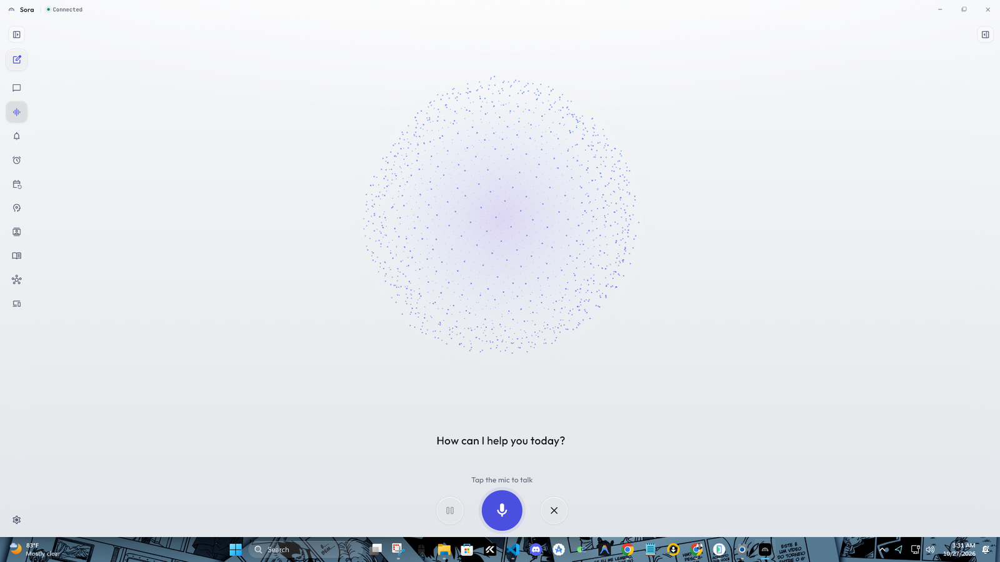
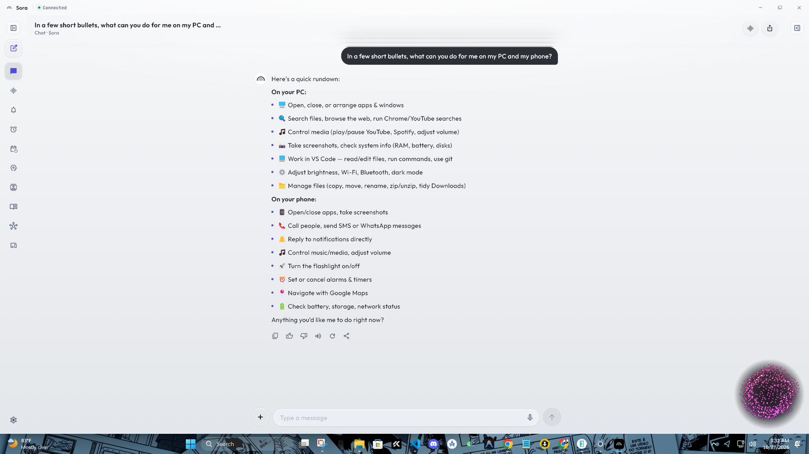
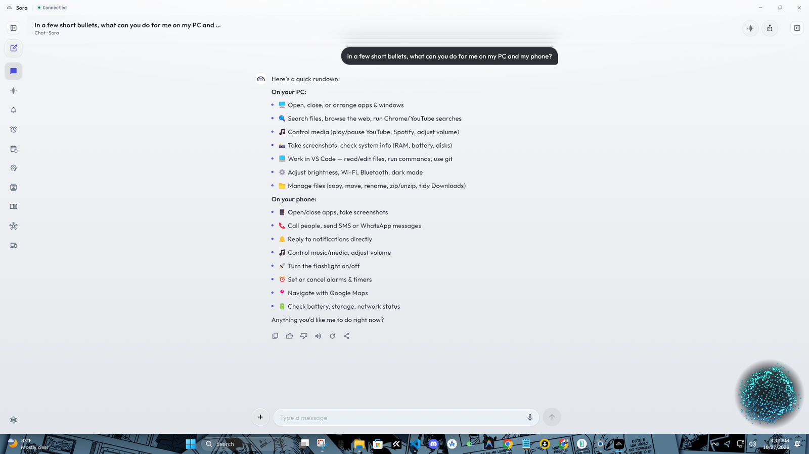
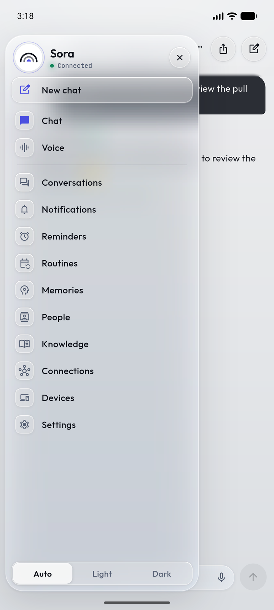

# Sora

**A personal AI assistant that lives on your own PC and works across your Windows computer and Android phone.**
Talk to it by text or voice, in English, Bangla or a mix of both. It can answer questions, use your Google
account, remember things for you, run routines on its own, and control both devices. Anything risky waits for
your approval.

<p align="center">
  
</p>

<table>
  <tr>
    <td align="center"><br><sub>Phone app</sub></td>
    <td align="center"><br><sub>Ask about the PC from the phone</sub></td>
    <td align="center"><br><sub>Reminders</sub></td>
    <td align="center"><br><sub>Voice mode</sub></td>
  </tr>
</table>

---

## Contents

- [What Sora can do](#what-sora-can-do)
- [Screenshots](#screenshots)
- [How it works](#how-it-works)
- [Getting started](#getting-started)
- [Configuration](#configuration)
- [Security and privacy](#security-and-privacy)
- [Development](#development)
- [Project layout](#project-layout)

## What Sora can do

| Area | What it does |
|---|---|
| **Chat and voice** | Chat with tool use through any OpenAI-compatible LLM (OpenRouter by default). It replies in the language you write in. Voice works hands-free with "Hey Sora" on the phone and on the PC. |
| **Your PC** | Open, close and arrange apps and windows, type and press shortcuts, copy, move, zip and tidy files, change brightness, Wi-Fi, Bluetooth, dark mode, media and volume, lock, take screenshots, shut down. It can also drive a browser and work in VS Code. |
| **Your phone** | Alarms, timers, calls, SMS, WhatsApp, apps, maps, flashlight, battery and storage status. The phone's notifications can show on the PC, and you can reply to them. |
| **Across devices** | Ask on the phone about the PC, or on the PC about the phone. The clipboard is shared between them, and the PC tells the phone when a download or a training run finishes. |
| **Google account** | Connect once to use Gmail, Calendar, Drive, Docs, Sheets, Slides, Tasks and Contacts. New mail is sorted by importance using rules you write in plain language. |
| **Memory and knowledge** | Remembers facts about you and the people in your life. Searches your notes, PDFs, Word files, web pages and Drive files (pgvector and full-text search). You can see and edit all of it. |
| **Reminders and routines** | One-off reminders, plus routines that run on a schedule or when something happens, such as "every morning at 8, tell me my calendar" or "when my phone battery is low, tell the PC". |
| **Approval first** | Sending mail or messages, deleting, shutting down and other risky steps always wait for your yes. |

## Screenshots

**Windows app: ask about the phone from the PC**



**Voice mode on Windows**



**The corner orb.** When you say "Hey Sora" on the PC, a small orb appears above the clock while Sora listens,
thinks and speaks. It never takes the focus, and clicks pass through it.

| Speaking | Listening |
|---|---|
|  |  |

**Phone app menu**



## How it works

Sora has three parts, and all of them run on hardware you own:

```
 Android app ──┐   HTTPS + SSE (chat)               ┌── Google APIs (OAuth, tokens encrypted at rest)
 Windows app ──┼── WebSocket (events, commands) ──  Sora backend (FastAPI) ── any OpenAI-compatible LLM
 PC agent ─────┘                                    │      ├── email watcher · reminders · routines
                                                    │      └── PostgreSQL + pgvector
                                                    └── FCM push to the phone (optional)
```

- **Backend** (`backend/`, Python/FastAPI). The brain: the LLM loop and its tools, memory, knowledge base,
  reminders, routines, the Google integration and the live connection to every device.
- **PC agent** (`pc_agent/`, Python, Windows). Carries out PC actions, listens for "Hey Sora", watches
  downloads and training runs, and syncs the clipboard. Idle CPU stays near zero.
- **App** (`app/`, Flutter). One codebase for Android and Windows. On Android, a light background link inside
  the accessibility service keeps the phone reachable while the app is closed, without an extra foreground
  service.

The phone finds the PC on the home network by itself. The server announces itself over UDP, and the phone
re-checks and follows the PC when the router gives either device a new address. Away from home, use
[Tailscale](https://tailscale.com).

## Getting started

### Requirements

| For | You need |
|---|---|
| Backend | Python 3.12+, PostgreSQL 15+ with [pgvector](https://github.com/pgvector/pgvector) |
| PC agent | Windows 10/11 and the same Python environment |
| Apps | [Flutter](https://flutter.dev) (Dart 3.12+). Android Studio to build the APK, Visual Studio (C++ desktop workload) and [Inno Setup 6](https://jrsoftware.org/isinfo.php) for the Windows installer |
| An LLM | An API key for OpenRouter or any OpenAI-compatible provider |

### 1. Backend

The steps below run PostgreSQL inside WSL Ubuntu on Windows (about 400 MB). On Linux or a VPS, any PostgreSQL
with pgvector works. Leave `WSL_DISTRO` empty, or run `docker compose up -d`.

```powershell
# PostgreSQL + pgvector inside WSL (Ubuntu)
wsl -d Ubuntu -u root -- bash -c "apt-get update && apt-get install -y postgresql postgresql-18-pgvector && systemctl enable --now postgresql"
"CREATE ROLE sora LOGIN PASSWORD 'choose-a-password';" | wsl -d Ubuntu -u root -- su postgres -c psql
"CREATE DATABASE sora OWNER sora;"                      | wsl -d Ubuntu -u root -- su postgres -c psql
"CREATE EXTENSION vector;"                              | wsl -d Ubuntu -u root -- su postgres -c "psql -d sora"

# Python environment
py -3.12 -m venv .venv
.venv\Scripts\python -m pip install -e "backend[dev]"

# Configuration: copy the template, then fill in DATABASE_URL, WSL_DISTRO, LLM_API_KEY, LLM_MODEL, OWNER_NAME
copy .env.example .env

# Encryption key, database tables and the owner PIN
cd backend
..\.venv\Scripts\python -m sora setup

# Run (API docs at http://localhost:8000/docs)
..\.venv\Scripts\python -m sora serve
```

You can also talk to Sora in the terminal with `python -m sora chat`.

### 2. PC agent

```powershell
cd backend
..\.venv\Scripts\python -m sora create-device --name "My PC" --kind pc_agent --save-as PC_AGENT_TOKEN
cd ..
.venv\Scripts\python pc_agent\sora_pc_agent.py      # add --allow-shell to permit PowerShell commands (each one is still approved)
```

If VS Code is installed, the agent adds the **Sora Bridge** extension to it ([vscode_ext/README.md](vscode_ext/README.md)).
Sora can then open projects, edit files, run terminal commands, use git and hand coding jobs to Claude Code.

To start the server and the agent with Windows, run `scripts\install_autostart.ps1`.

### 3. Apps

```powershell
cd app
flutter pub get

# Android: app\build\app\outputs\flutter-apk\app-release.apk
flutter build apk --release

# Windows installer: app\build\installer\Sora-Setup-<version>.exe
powershell -ExecutionPolicy Bypass -File windows\installer\build.ps1
```

Open the app and enter the server address and the PIN you chose in `sora setup`. On the same Wi-Fi the phone
finds the PC by itself. On Android, turn on **Sora** under *Settings → Accessibility* so the phone stays
connected in the background and can carry out actions.

### Optional

- **Google:** follow [docs/google-setup.md](docs/google-setup.md) ([বাংলা](docs/google-setup.bn.md)). It takes
  about 15 minutes, once. Then press *Connect Google* in the app, or run `python -m sora connect-google`.
- **Away from home:** run `tailscale serve --bg 8000` on the PC to get a private HTTPS address that only your
  devices can reach.
- **Push notifications:** create a Firebase project, download a service-account key, keep it outside the repo,
  and set `FCM_SERVICE_ACCOUNT_FILE` in `.env`.

## Configuration

Every setting lives in `.env`. [.env.example](.env.example) lists and explains all of them. The main ones:

| Setting | What it is |
|---|---|
| `DATABASE_URL` | PostgreSQL connection (use `127.0.0.1`, not `localhost`, with WSL) |
| `LLM_BASE_URL`, `LLM_API_KEY`, `LLM_MODEL` | The chat model. Any model that supports tool calling |
| `EMBEDDING_*` | Optional. Without a key, search falls back to PostgreSQL full-text search |
| `GOOGLE_CLIENT_ID`, `GOOGLE_CLIENT_SECRET` | Your own Google OAuth client ([setup guide](docs/google-setup.md)) |
| `STT_PROVIDER` | Speech-to-text: `local` (Whisper on your GPU), `groq`, `openai` or `none` |
| `PC_AGENT_TOKEN` | The PC agent's device token (created by `sora create-device`) |
| `WAKE_WORD`, `CORNER_ORB` | "Hey Sora" on the PC, and the corner orb |

### A free setup

| Part | Free option |
|---|---|
| LLM | OpenRouter `:free` models, or the Gemini or Groq free tiers. ⚠️ Free tiers may use your data, including email content, for training. |
| Embeddings | Gemini `gemini-embedding-001`, or none (full-text search) |
| Speech-to-text | On-device on Android. On Windows: the Groq Whisper free tier, or local `faster-whisper` on the GPU (`pip install -e backend[local-stt]`) |
| Text-to-speech | Edge TTS |
| Hosting | Your own PC, with Tailscale for access from outside |

## Security and privacy

- **Your data stays with you.** The server, database and files run on your own machine. Only the LLM provider
  you choose sees the conversation.
- **Secrets stay out of git.** `.env` and `data/` are ignored, and `.env.example` holds no values. A gitleaks
  pre-commit hook blocks commits that contain keys. Run `git config core.hooksPath .githooks` once after cloning.
- **Google tokens are encrypted** at rest with Fernet (`ENCRYPTION_KEY`).
- **Each device has its own revocable token.** Only SHA-256 hashes of tokens are stored.
- **Untrusted content is fenced off.** Email, file and web content is marked untrusted for the LLM. Once such
  content is in a conversation, anything that could send data out or store injected text waits for approval.
- **Risky actions ask first:** sending, deleting, shutting down, paying or posting in the browser, terminal
  commands in VS Code, and PowerShell on the PC (off unless the agent is started with `--allow-shell`).
- **The browser Sora drives** uses its own profile and never types passwords. You log in yourself.
- If a key ever leaks, **rotate it**. Deleting the commit is not enough.

## Development

```powershell
cd backend
..\.venv\Scripts\python -m pytest -q          # backend tests (uses a separate sora_test database)
cd ..
.venv\Scripts\python -m pytest -q pc_agent/tests
cd app
flutter analyze lib packages/sora_phone/lib   # Dart is formatted at width 140
```

New phone or PC actions, and the order of planned automation work, are described in [CLAUDE.md](CLAUDE.md) and
[docs/automation-roadmap.md](docs/automation-roadmap.md). The client protocol is in [docs/api.md](docs/api.md).

## Project layout

```
backend/sora/
  agent/        LLM loop, system prompt and tools (Google, knowledge, reminders, devices, people)
  api/          REST and WebSocket routes (auth, chat, connections, knowledge, voice, ws)
  google/       OAuth and REST helpers for Gmail and Workspace
  llm/          OpenAI-compatible chat and embedding clients
  services/     email watcher, reminders, routines, RAG, device hub, voice, phone discovery
pc_agent/       Windows agent: PC actions, "Hey Sora", corner orb, watchers, clipboard, VS Code bridge
app/            Flutter app for Android and Windows
  lib/            screens, shells and shared widgets; l10n/strings.dart holds English and Bangla
  packages/sora_phone/   Android plugin: phone actions and the background link (Java)
vscode_ext/     Sora Bridge, the VS Code extension
scripts/        setup, autostart and wake-word training helpers
docs/           client API, Google setup, automation roadmap, screenshots
```

CLI: `python -m sora setup | serve | migrate | set-password | create-device | chat | connect-google | reindex | poll-email`
